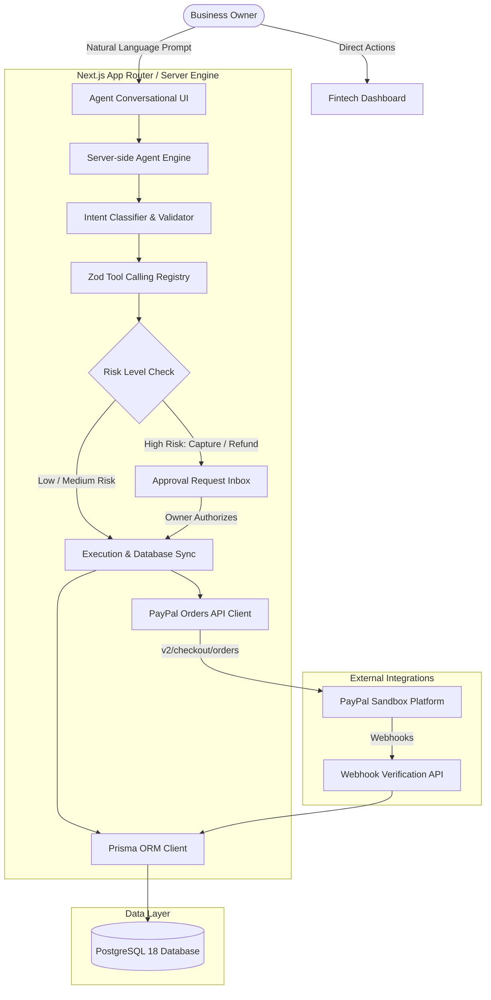

# FlowPilot AI — Technical Architecture

## 1. System Overview

FlowPilot AI is an autonomous financial operations platform designed for freelancers, digital agencies, and B2B merchants. It unifies natural language agentic interactions with official PayPal checkout, automated reconciliation, and AG Grid ledger intelligence.

## 2. Layered Responsibilities

1. **Presentation Layer**: Next.js App Router with React 18, Tailwind CSS, Lucide icons, Recharts, and AG Grid Community for tabular transaction intelligence.
2. **Security & Session Layer**: Password hashing via bcryptjs, JWT session tokens signed with `jose` using HS256, and HTTP-only cookie persistence.
3. **Agent Orchestration**: Deterministic plan generation, tool execution with Zod runtime validation, and risk-rated approvals.
4. **PayPal Gateway Layer**: Direct integration with PayPal Sandbox Orders API v2, captures, webhooks, and signature verification.
5. **Persistence Layer**: Strictly normalized PostgreSQL schema with 26 models, UUID primary keys, and decimal currency fields.

