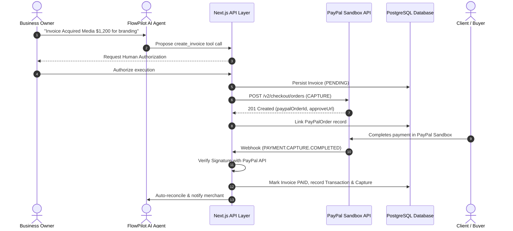

# FlowPilot AI — Hackathon Judge Guide
**PayPal AI Hackathon 2026: Build What's Next with PayPal and AI**

Welcome, Hackathon Judges! This document outlines FlowPilot AI's technical architecture, core innovations, live evaluation pathways, and how we directly meet and exceed all judging criteria.

---

## 1. Quick Evaluation Matrix

| Category | FlowPilot AI Implementation | Evaluation Criteria Met |
| :--- | :--- | :--- |
| **PayPal Sandbox Integration** | Real Orders API v2, Dynamic Checkout generation, idempotent Captures, Webhooks verification (`v1/notifications/verify-webhook-signature`), Refunds. | **Core Payment Foundation** |
| **Agentic AI Orchestration** | 6-stage autonomous pipeline: Intent Extraction → Context Retrieval → Risk Gating → Human Approval → Tool Execution → Result Verification. | **Advanced Agentic Commerce** |
| **Zero Hallucination Guarantee** | 21 strictly typed Zod tools. LLM never generates numbers or runs arbitrary SQL; all financial figures are calculated from PostgreSQL. | **Trust & Financial Integrity** |
| **Enterprise Financial Data** | 26 normalized Prisma models with `Decimal(12,2)` precision, double-entry audit logging, and AG Grid Community data ledger. | **Enterprise Scalability** |
| **Automated Cash Flow Operations**| Proactive overdue invoice tracking, automated follow-up dispatch, and automated transaction reconciliation. | **Autonomous Operations** |

---

## 2. 3-Minute Quick Judge Walkthrough

To review the project in under 3 minutes:

### Step 1: Login
- Navigate to `http://localhost:3000/login` (or hosted demo URL).
- Click **"Use Founder Demo Credentials"** or enter:
  - **Email:** `ritesh@flowpilot.ai`
  - **Password:** `Demo1234!`
- You enter the live **Apex Digital Dynamics** financial console.

### Step 2: The Agentic Workspace (`/dashboard/agent`)
- Click **"AI Financial Agent"** in the sidebar.
- Prompt the agent:
  > *"Create a $500 invoice for John for website development"*
- **Observe:** The agent extracts the entity, identifies customer "John" (or drafts a new client record), plans the operation, generates a structured proposal, and halts for user confirmation.
- Authorize the operation to trigger the database record and PayPal Order generation.

### Step 3: Automated Payment Follow-ups (`/dashboard/automation`)
- Click **"Autonomous Workflows"**.
- Review the active rule: *"Send gentle payment reminder 3 days before due date"*.
- Click **"Run Automated Check"** to watch FlowPilot inspect outstanding balances, detect delinquent accounts, draft notifications, and log all events in the immutable audit trail.

### Step 4: AG Grid Financial Ledger (`/dashboard/payments`)
- Open the **Payments Ledger** to experience high-performance transaction filtering, status sorting, currency formatting, and quick refunds powered by AG Grid Community.

### Step 5: PayPal Sandbox Checkout & Verification
- Click on any invoice in `/dashboard/invoices`.
- Click **"Pay with PayPal"** to launch the official PayPal Sandbox Checkout popup/redirect.
- Log in with your PayPal Sandbox buyer account or use the provided test credentials.

---

## 3. PayPal Sandbox Architecture

FlowPilot AI implements official PayPal REST APIs using server-side client-credentials OAuth 2.0 authentication:

---

## 4. Security & Compliance Checklist

- [x] **No hardcoded secrets**: All API secrets, database passwords, and signing keys are isolated in environment variables.
- [x] **Human-in-the-Loop (HITL)**: High-impact actions (creating invoices, issuing refunds, dispatching external communications) require explicit business authorization.
- [x] **Webhook Signature Verification**: Handled through PayPal's `/v1/notifications/verify-webhook-signature` endpoint preventing spoofed webhooks.
- [x] **SQL Injection Free**: 100% parameterization via Prisma ORM.
- [x] **Audit Trail**: Every AI tool invocation and user approval is recorded in `AuditLog` with before/after state snapshots.

---

## 5. Contact & Links
- **GitHub Repository:** [https://github.com/Rit2sh/FlowPilot-Ai](https://github.com/Rit2sh/FlowPilot-Ai)
- **Founder / Lead Architect:** Ritesh Rajput (`ritesh@flowpilot.ai`)
- **Built for:** PayPal AI Hackathon 2026 on Devpost
